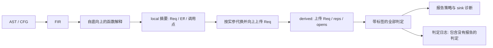

# 摘要、诊断与真实代码排查

本文面向规则使用者与评审者；规格是 06-spec.md，增量行为以 SPEC-0122 起的规格为准。业务源码、函数名和告警原文留在公司环境。

## 为什么可以放在 core 并使用 ipa=none

这里有两个不同的过程间分析器。CSA 的 ExprEngine 从入口沿路径执行，可在调用处内联；ipa=none 控制的是它。
OobSummary 只注册 check::ASTDecl<TranslationUnitDecl>：先用 Clang AST/CFG 得到 FIR，再运行自己的抽象解释、摘要代换和传播。
所以 core 是公司运行体系的分类，不表示本规则只有单函数能力。Phase=inline 是“本 TU 内的摘要求解”，也不是开启 CSA inline。
只启用本规则时，ipa=none / dynamic-bifurcate 的判定应完全相同；混合启用其它 checker 时，其它规则会受 CSA IPA 配置影响。
统一写 ipa=none，既表达依赖关系，也与公司 core / cmn 的默认运行方式一致。

## 函数摘要、判断指纹和告警分组分别标识什么

**摘要的分析单位是函数。** 同一目标内用函数键 key 区分函数，重载、模板实例化、不同文件的 static 函数可以有不同的键。
每个函数的 local / derived 是两种视图；额外保存哪些函数由 DumpFilter 控制，和要复核几条告警没有一一对应关系。

| 标识 | 对应的对象 | 用途 |
|---|---|---|
| 函数 key | 一个目标内的函数 | 查找、代换和复用该函数的摘要 |
| 摘要文件 stem | 目标与函数键的哈希 | 从 index.json 的 fn / key 找到 local / derived 文件 |
| 判断指纹 fp | 按判断特征生成的检索标识 | 从一个问题查判断记录与调用链；SAFE / 未报记录也有 |
| report_group / warning 的 group | 同目标、同 sink 文件与行的物理告警组 | 查看合并到一条 warning 的多个原判断 |

fp 由标签、证明上下文函数键、访问函数键、读写种类、访问末端式与对象写法计算，不含行号。
同一函数可有多个 fp；相同指纹也可能对应多个日志记录或上下文，不把它当作每条日志的唯一序号。
stem 与 fp 都是十六进制字符串，但含义不同，不能互换。

例如 A → B → C，实际下标访问在 C：A、B、C 各有自己的函数摘要。选一个问题的 fp，只是让 explain 找到这条问题的证据链，再去看 A、B、C 的摘要。
其它调用者也可以复用 C 的同一份参数化摘要，在各自实参下得到不同判断。不会因为多选一个 fp，就为 C 重新定义一种摘要粒度。
已经知道函数名时，可以直接打开对应FIR的funcs[].name确认显示名，或任选summary --list盘点；无需从判断指纹开始。保存与查看是两次动作，详见下节。
用 summary --function NAME --view local / derived 查看，不必手动拼 stem。完整命令见 COMPANY.md §0。

空 index.json 表示本次没有保存函数摘要，不能解释成没有分析函数。Dump=summary 开启而 DumpFilter 未匹配时，旧实现会静默写 []；
SPEC-0129 起明确打印 available / matched / saved / write_failures，并写 dump/solve/summary/status.json。
available>0 且 matched=0 是筛选零匹配；available=0 需检查 FIR 加载；saved<matched 或 write_failures>0 需检查写盘。
可以复用完整 FIR 只重跑 solve，保留原有模型与策略；无需再 export/report。选择器只缩小调试输出，不减少实际求解工作。
新的 Python 盘点和查询也兼容旧二进制的索引；未知函数在启动 bxen 前就失败，不会等完整 solve 才发现选错。

## 哪一步计算、哪一步保存、哪一步只是读取

solve总会求解输入FIR集合，不论有没有--summary-function。这个参数只表示“额外保存选中函数的两种摘要”，没有缩小分析范围。
它默认先用Python扫描全部FIR预检名字；--skip-summary-precheck省掉这遍扫描，代价是名字错误要等完整solve后发现。底层bxen仍需正常read全部FIR。
summary --list同样解析全部FIR，--contains/--limit只筛选展示，不表示只读部分文件。它是可选辅助工具，可以直接打开已知TU的FIR查看funcs[].name/key与顶层target。
FIR JSON中是name字段，已保存摘要和索引中是fn字段；函数体指令不等于求解后的摘要。

| 动作 | 是否重新分析 | 是否生成摘要文件 | 是否必须用脚本 |
|---|---|---|---|
| export | 降级源码为FIR | 否，生成每TU的FIR | 驱动编译输入 |
| solve无保存选项 | 是，全体FIR | 否，仍生成solved判断 | 驱动求解 |
| solve --summary-function | 是，全体FIR | 只存选中的local/derived | 也可直接给bxen Dump/Filter |
| solve --summary-all | 是，全体FIR | 保存全部；不逐函数打印JSON | 新增的便捷保存模式 |
| summary --function | 否，仅读索引及所选正文 | 否 | 可直接打开JSON |
| summary --list | 否，盘点全部FIR的名字/键 | 否 | 可直接打开对应FIR |
| explain | 否，扫描判断日志并关联已保存摘要 | 否 | 可直接看判断JSON的fp/chain等 |

SPEC-0130的Dump=summary-files仅在solve持久化local/derived/index/status，不逐函数打印到stderr。--summary-all设置progress+summary-files且将DumpFilter覆盖为匹配全部的 `.*`；需要同步编译新版checker。
旧Dump=summary保持stderr JSON和落盘兼容。不加筛选也能存全部，但会把全部local再次打进日志；全量时推荐只落盘模式。
开启保存时，每个目标组先在内存完成analyze/propagate/decisions，再保存摘要并写solved，最后汇总index。新summary阶段用于观察保存进度。
进程退出后文件仍在，随时读；summary工具不重算、不补生成。已经选中保存的函数无需再次solve。
若未保存某个函数，solved只有判断，不能反推全部参数化Req/Eff/calls，FIR也只是原始指令；要补齐只能在下一次solve保存。
想之后任意选函数，可以在下一次计划运行时选择--summary-all。每函数两份文件，当前26.8万函数约53.6万份正文，增加磁盘空间、inode与时间；不默认强制用户付出这个成本。

变量赋值可以写OOB_SUMMARY_NAME='Top_A'；单引号不属于值。占位用的尖括号和反引号不要照抄进实际名字。
摘要路径是WorkDir/dump/solve/summary：index按fn/key/target给stem，正文是stem.local.json和stem.derived.json；stem与判断fp不同。

## 一个函数的摘要为什么包含其它函数和调用链

摘要描述的是“调用这个函数时，它以及它调用的函数可能访问什么、改变什么”，不是只罗列本函数的语句。

* Req 是安全访问需要满足的条件。例如被调者对 p[i] 写一个 4 字节元素，需要 `4*i+4 <= ext(p)`。
* Eff 是返回值、分配结果、写字段 / 全局等效果。父函数解释到调用处时应用这些效果。
* calls 保存调用位置、实参、当时的守卫与局部区间。它不是把所有调用路径展开一遍。
* reps 是在这个函数的上下文中已经能定级的结果；chain 是这条结果的证据链，最后一跳才是访问点。
* opens 是暂时无法证明的项目及原因；不等于已经证明存在越界。

例如自带的 LV1-01 金标准：入口把枚举终值 4 向下传三层；底层对只有 4 个元素的全局整数数组执行一次写。
有效下标是 0..3；4 字节元素的访问末端为 `4*4+4=20`，容量 16。因此入口上下文可以给出 DEFINITE，并保存从入口到访问点的证据链。
这仍是入口函数的摘要：它的行为包括这次调用带来的访问。底层函数的摘要保留形参符号；代入 4 之后才有入口的具体结论。

`cases/summaries/*.json` 是人工审定的完整金标准，既有局部事实，也有可核对的传播结果。`doc` 是说明文字，不参与推理。
实现中 BuildSummary 生成真实的 local 事实；Propagate 从局部 Req 和调用点重算上传和判定，不把金标准里的 reps 文本当作求解输入。
新的摘要文件分 local / derived 两种视图：前者对应真实解释结果（其中已利用可用的被调者效果），后者保留参数/调用点/效果并替换为传播后的Req/reps、补入口opens。打印摘要是观察同一套引擎的结果，不是另做一遍展示用的分析。

## 复杂度降低多少、是不是不再受调用层数限制

不能给一个普遍成立的倍数。路径执行的成本与分支组合、循环展开、内联次数和上下文数量相关；相同被调函数可能在很多调用上下文重复执行。
摘要把函数的行为用有限抽象状态合并，在调用点只代换相关条件，避免为每个入口重新执行整条深链。
这是成本结构的改变，不是所有程序上的固定加速比，也不能拿两者覆盖程度不同的运行时间直接算速度提升。

设函数数为 F、调用边数为 E、函数 f 的 CFG 规模为 B_f、解释更新次数为 I_f、传给调用点 c 的 Req 数为 R_c。
主要成本可粗略拆成 `sum(B_f * I_f * 单次转移成本) + sum(R_c * 代换与判定成本)`，还要加汇合、守卫比较和访问覆盖合并。
这些“单次成本”并非常数：表达式、内存格、效果、别名假设越多就越贵。当前 Absorb 对候选条件做两两比较，候选多时有平方项。
分支很多、每层增加互不覆盖的 Req、密集调用图、大量对象 / 字段、重复头文件实例都能把时间或内存撑大。
不承诺任意极端输入恒定耗时、线性复杂度或绝不耗尽资源。

没有固定的调用深度截断。InlineDepth 是报告过滤阈值，不是求解深度；默认 0 后浅层也报告。
有限的非递归直接调用链可以继续上传，但“层数能到达”不等于“每一层都能得到精确结论”。
当前明确边界包括：

* 默认 MaxBlocks=5000；超出时记 skipped / SUSPECT，不把它当作安全。
* 循环头更新最多 20 次、下降收窄 2 遍；守卫最多 8 条、返回值情形 4 个、局部关系 8 条、子对象窗口 4 个。
* 表达式与区间做有界近似；复杂非线性、数据驱动步长、某些别名关系会丢精度，转入 SUSPECT。
* 递归不求跨 SCC 不动点，环上调用点记 recursion；函数指针只解析有限的局部常量目标。
* 缺定义、缺模型、不支持的 C++ 成员调用、未知对象大小或丢失的约束都可能使精确结论停在某层，但应有账本。
* 当前 solve 单进程；FIR、摘要、局部事实与判定同时占内存。模块 / 条件数量会限制全量规模。不同目标的 ABI 不能混用。

已有合成压测能说明特定形态的能力，不能代替最坏情况证明。公司这次全板实测是最有用的运行基准：
10245 个 FIR TU，solve 19m49.53s，峰值 30840260 KiB，约 29.4 GiB；这是单次观察值。
“9 秒 / 257 MiB”指之前 116 文件子系统的一次求解耗时和峰值内存，不是每文件成本，不能按 TU 数直接线性放大。
全板 export / report 旧批次各约7分钟；2026-11-04新批次10257个FIR、2231627条判断的solve命令为25:07.76、47346220 KiB≈45.2 GiB。包含驱动预检/尾部统计，不归因成纯摘要计算变慢；摘要文件只存2个，不能用来估算保存全部的额外耗时。
下次先与同一输入/选项基准比较，再结合进度阶段、CPU/RSS和Req数量判断。

## 如何理解越界分类与 SUSPECT

访问种类和 Lv1..Lv10 场景是两组维度：前者说“哪种语句”，后者说“分析需要哪些能力”。
数组下标、成员访问、带偏移指针的解引用、内存函数读写是访问；尚未建模的函数调用是交出指针的账本，不能写成已发生越界。
只计算一个指针、尚未访问内存，不等于本规则一定报告；形成合法 one-past 指针也不等于越界访问。

字节仍是最终判定单位，因为强转、成员偏移和拷贝可能访问半个元素；诊断同时展示访问类型、元素大小与可换算的元素容量。
“exclusive end=64”表示最靠后的访问可结束在起点后第 64 字节，不表示读取了 64 字节，也不表示原始源码写了下标 64。
20 字节结构体数组 a[3] 的某个 4 字节首字段：最后合法元素索引 2；索引 3 的该字段末端正好是 `3*20+4=64`，超过 60 字节对象。
合成对照中 i<n 安全，i<=n 会报告；业务代码的 64/60 只能说与这个形态吻合，仍需查看自己的循环条件、索引范围与字段偏移。

`type_range_only` 的人类说明是“没有找到可用的代码约束”。它不证明源码完全没有检查；检查可能约束了另一个值、被修改失效、可能回绕、或引擎尚不支持。
例如 65535 可能来自 uint16 类型上界。给 4 字节标量取地址本身不触发这样的长度结论，须看末端的读写到底使用哪个长度。
`entry_unproven` 表示 Req 到分析入口后仍未证明。先读 R / W 和实参编号，不能看到 past[i] 就把对另一实参的写误解成该数组的读。
MIN 宏按 ?: 降级。36 个元素而夹到 96 的合成对照报 POSSIBLE；夹到 36 的对照证明安全。其它未知目的对象上的写是独立判断，不能借这个上界一起证明。
`untracked_pointer` 也包括全局指针：指针变量有静态类型不代表知道指向对象的分配长度；变量自己的 sizeof 是指针宽度，不是目标容量。
`cxx_call` 是成员函数 / 构造函数暂未建模的账本。例如释放调用本身不证明发生越界。

## 缺定义的函数怎么建模

unknown_callee 表示当前求解集合里没有可匹配的定义，也没有可用模型；可能在外部库、汇编、漏导出的 TU 或另一目标中。
它是指针交出后可能被访问 / 修改的保守记录，不是断言函数必然越界。先检查导出覆盖和键，再考虑模型。

现有 YAML 支持四类，不止“分配器 + 安全函数”：

| 模型 | 描述什么 | 适用前提 |
|---|---|---|
| access | 哪个指针实参被读 / 写、字节数表达式、发生条件、实际字节数是否只有上界 | 函数行为可用当前模型语法表达 |
| allocators | 返回新对象、分配大小用哪个实参表达式 | 返回值确实指向这次分配的对象 |
| free | 释放类函数 | 已确认释放语义 |
| pure | 对本规则而言不访问相关缓冲区、不修改被跟踪内存 | 必须确认契约；它不能替代“返回长度”的模型 |

不要为消除告警把所有未知函数都放进 pure。字符串长度函数会读取字符串；把它当作无需检查的 pure 会丢掉读访问，也不会自动得到正确返回值。
长度扫描、格式化封装的精确行为要依据原型和实现契约决定，不能仅凭名称猜形参或截断行为。
固定长度读写可以用 access；有界格式化可在确认参数后建模其最大写入长度；字符串扫描长度未知时仍需保留不确定性。
返回条件、出参写值、字段初始化等一般函数优先提供其定义给摘要引擎，当前 YAML 不是任意函数的通用语义语言。
模型文件只留在公司；如何加载及 Dump=models 的确认方法见 COMPANY.md。

## 场景分布的统计口径

warning 的 [access=...] 表示访问种类，[scene=LV2+LV3] 表示已观察到双侧代换 / 算术与控制流特征，和 DEFINITE / POSSIBLE / SUSPECT 标签及 depth 是不同维度。
真实问题可以有多个特征；脚本默认取最高已观察等级作主类，使主类行合计等于统计单位数。--multi 给出并集分布，行合计可能更大。

| 场景 | 自动标签的证据范围 |
|---|---|
| Lv1 | 简单可解释的访问，没有识别到更高因素 |
| Lv2 | 原 Req 包含多个接口形参、下标算术或掩码 |
| Lv3 | 已保留的代码检查、分支、循环界 |
| Lv4 | 分配 / 返回值效果来源 |
| Lv5 | 原条件依赖字段值，或指针来源包含指针字段 |
| Lv6 | 当前全局值 / 动态全局指针；固定全局数组本身不自动升为 Lv6 |
| Lv7 | 尾数组约定、内层界、下溢、typed_field，或记录视图大于可用对象 |
| Lv8 | 访问表达式中识别到非线性因素（目前两变量乘法）；不保证识别所有复杂循环 |
| Lv9 | 未解析调用、外部缺定义、函数指针、递归或未建模 C++ 接收者 |
| Lv10 | 业务隐式契约需要人工标注，当前不自动推断 |

这些是 observed_features，不是把每个真实问题精确还原成 04- 中某个子场景；“这条有 Lv7 特征”也不表示 Lv7 全部场景均精确支持。
无法识别足够证据的显示 UNCLASSIFIED，旧版没有标签的数据也在此列；不能把这些记录算成 Lv10 或“已经支持”。
专家可在公司用 scene_stats.py --annotations 补分类，仅影响统计，不影响 checker 的判断或报告。

统计默认以物理 warning 的 report_group 为单位，原始 judgment 是另一口径：同一源行的 D/P/S 多个上下文合在一条 warning 中，主标签取最严重者，其他上下文并不因此成为 DEFINITE。
--unit decisions 可以看原判断分布，--include-unemitted 包括 SAFE / 策略过滤的日志；默认只计报出的记录。
机器 reason type_range_only 保持兼容，其人类说明是“没找到可用的代码约束”。

## 尾数组选项与真实分配长度

FlexibleArrayMax=4 / ReportFlexibleArray=false 是用户明确选定的报告例外：结构体最后一个 []、[0]、[1]、[4] 可作为 payload 约定候选，普通固定数组、非末尾成员和 union 保留检查。
阈值0只保留[]/[0]，超过阈值的照常报告；该策略也可能过滤真正越过实际分配的访问，不能用它证明安全。
同一原判断的 label / range 不改，日志以 not_emitted_because=flexible_array 说明未报；ReportFlexibleArray=true 恢复按标签报告。
来源在目前能跟踪的局部、字段、返回效果与调用替换中传播。普通指针路径、固定内层窗口不会因候选路径一起被过滤。
没有跟踪到来源的复杂字段链仍保守报告；不根据表面变量名猜测它一定是尾数组。

元素容量是按已知可用字节 / 元素视图大小换算的完整元素数。指针进入对象内部后，available extent 是该检查位置的剩余可用空间；如果记录了整个局部对象大小，会另列 modeled whole-object extent。
它不保证等于源码最初的数组长度或 allocator 在机器上的全部物理块大小；分配器模型、管理头约定和内层窗口都可能改变检查的对象边界。

## 摘要里的 reported 和真正的输出

金标准的 reps.reported 是历史报告策略的参考快照；当前 core 传播记录在 report 应用 Policy 之前生成，不能据此认定这次是否真的打印。
实际结果以 decisions/*.jsonl 的 label / reason / emitted / not_emitted_because 为准。
report_group / diagnostic_primary 表示该判断参与哪一条物理 warning；合并不删除原判断。查询 warning 的 group 编号会列出全部原上下文。
local 摘要和 derived 视图是求解前后可查阅的两层数据；真实 checker 的判断来自同一套 BuildSummary + Propagate，并不读取 doc.msg 来决定告警。

C++ 成员调用的 cxx_call 是暂未建模 this / 调用效果的账本；当前通用 YAML 模型主要匹配直接调用，不能仅把一个成员函数名填进 free 就假定已补上 this 的摘要。
同一 WorkDir 也必须对应一个程序集合。不同目标已经隔离；同一主文件的不同编译配置仍需确认，cdb 给出的变体差异计数不是已解决多变体分析。
